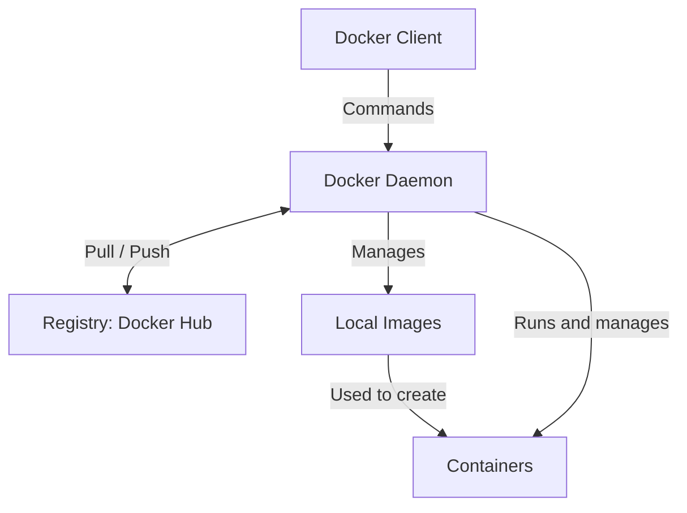
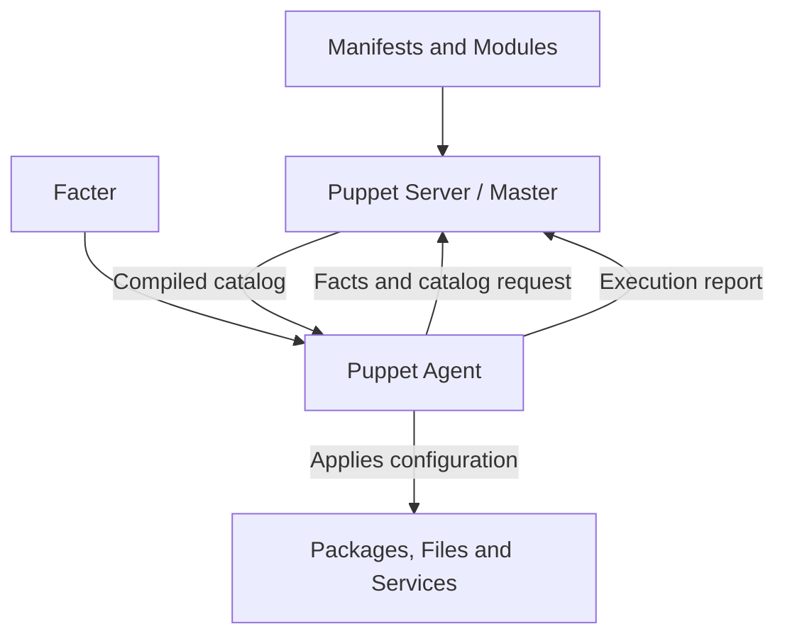
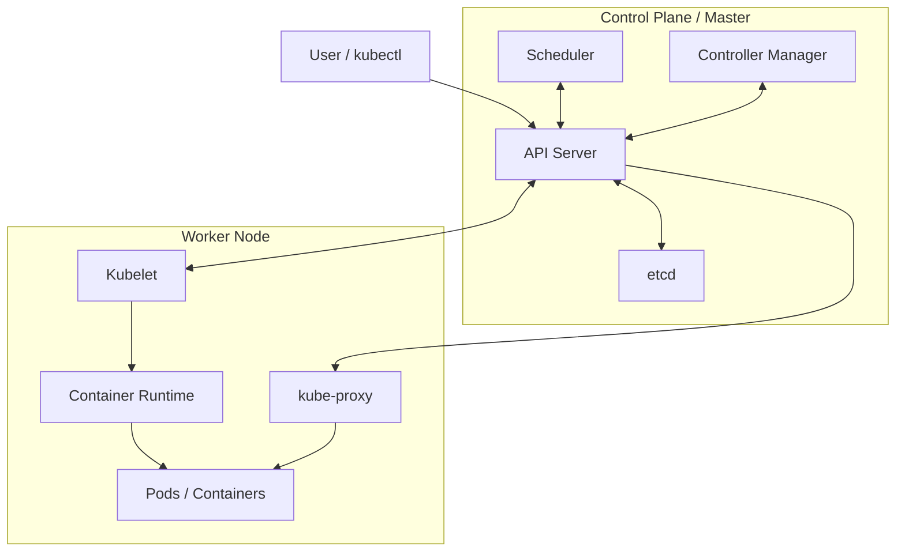

# DevOps Lab: Complete Exam Preparation

All eight experiments in **lab-record order**, with short aims, descriptions, procedures, code, results, and memory cues. Docker, Puppet, and Kubernetes architecture explanations are included with their respective experiments.

## Contents

1. [DevOps principles, practices, and responsibilities](#experiment-1-devops-principles-practices-and-responsibilities)
2. [Version control tools](#experiment-2-version-control-tools)
3. [Git installation and GitHub operations](#experiment-3-git-installation-and-github-operations)
4. [Jenkins installation and build job](#experiment-4-jenkins-installation-and-build-job)
5. [Docker architecture, lifecycle, and commands](#experiment-5-docker-architecture-lifecycle-and-commands)
6. [Jenkins master–slave experiment](#experiment-6-jenkins-masterslave-experiment)
7. [Puppet experiment and architecture](#experiment-7-puppet-experiment-and-architecture)
8. [Deploy a containerized application on Kubernetes](#experiment-8-deploy-a-containerized-application-on-kubernetes)

**Environment:** Git installation commands use Ubuntu. Jenkins build commands are provided for Windows and Linux. The Puppet experiment uses Windows and Chocolatey. Docker commands follow Docker Desktop on Windows. Kubernetes commands work in a terminal or PowerShell with Docker, kubectl, and Minikube installed.

## Experiment 1: DevOps Principles, Practices, and Responsibilities

**Aim:** To understand DevOps principles, practices, and the responsibilities of a DevOps engineer.

**Description:** DevOps combines development and operations to deliver software faster and more reliably through collaboration and automation.

### Principles

- **Collaboration:** Development and operations work together.
- **Automation:** Automate repetitive tasks.
- **CI/CD:** Integrate, test, and release changes regularly.
- **Monitoring and feedback:** Observe performance and improve continuously.
- **Infrastructure as Code:** Define and manage infrastructure using code.

### Practices

Version control, automated testing, CI/CD pipelines, configuration management, monitoring, logging, and microservices.

### Engineer responsibilities

1. Build and maintain CI/CD pipelines.
2. Automate builds and deployments.
3. Manage cloud infrastructure.
4. Monitor performance and security.
5. Coordinate with development and operations teams.
6. Troubleshoot deployment issues.

**Code:** Not required.

**Result:** Understood DevOps principles, practices, and engineer responsibilities.

**Remember:** Collaborate → Automate → Deliver → Monitor → Improve.

## Experiment 2: Version Control Tools

**Aim:** To explore version control tools used for source code management.

**Description:** A Version Control System (VCS) records file changes, maintains history, and supports teamwork, branching, merging, and restoring previous versions.

| Tool | Purpose |
|---|---|
| Git | Distributed version control system. |
| GitHub | Hosts Git repositories and supports collaboration. |
| GitLab | Git repository platform with integrated CI/CD. |
| Bitbucket | Atlassian's Git repository hosting platform. |
| Apache Subversion (SVN) | Centralized version control system. |

**Benefits:** Track changes and authors, collaborate, restore previous versions, develop on branches, and merge changes.

**Code:** Not required for this theory experiment.

**Result:** Studied version control tools and their benefits.

**Remember:** Git tracks versions; GitHub hosts repositories.

## Experiment 3: Git Installation and GitHub Operations

**Aim:** To install Git, create a GitHub repository, and perform basic Git operations.

**Description:** Git tracks changes locally. `add` stages files, `commit` saves a snapshot, and `push` uploads commits to GitHub.

### 1. Install and configure Git

Run installation commands in Ubuntu. Replace the example identity with your own.

```bash
sudo apt update
sudo apt install git -y
git --version
git config --global user.name "Your Name"
git config --global user.email "you@example.com"
```

### 2. Create a local repository and commit

```bash
mkdir GitDemo
cd GitDemo
git init
echo "Hello Git" > file.txt
git status
git add file.txt
git commit -m "Initial commit"
```

### 3. Connect to GitHub and push

Create an **empty** repository on GitHub first. Replace USERNAME and REPO; authenticate using your configured GitHub credentials when required.

```bash
git branch -M main
git remote add origin https://github.com/USERNAME/REPO.git
git remote -v
git push -u origin main
```

### 4. Branch, change, commit, and merge

```bash
git checkout -b feature
echo "New feature" > feature.txt
git add feature.txt
git commit -m "Add feature"
git checkout main
git merge feature
git push
```

**Result:** Created a repository, committed and pushed changes, and merged a feature branch.

**Remember:** Init → Add → Commit → Push; Branch → Change → Commit → Merge.

**Code file:** [03-git/commands.sh](03-git/commands.sh). These are reference commands; replace placeholders and use a new demo folder.

## Experiment 4: Jenkins Installation and Build Job

**Aim:** To install and configure Jenkins and execute a simple build job.

**Description:** Jenkins is an automation server used in CI/CD. A build job executes configured commands and displays the output.

### Procedure

1. Install a compatible JDK and Jenkins LTS. For Windows, run the installer and select the folder, service account, Java path, and port 8080.
2. Open `http://localhost:8080`.
3. Unlock Jenkins using the `initialAdminPassword` file at the location displayed on the unlock page.
4. Install suggested plugins and create an administrator account.
5. Select **New Item → enter a name → Freestyle project → OK**.
6. Select **Build Steps → Add build step → Execute Windows batch command**.
7. Enter:

```bat
java -version
dir
```

8. Click **Save → Build Now**.
9. Open the latest build under **Build History → Console Output**.

On Ubuntu, select **Execute shell** and enter:

```bash
java -version
ls -l
```

**Expected output:** Java version, workspace file listing, and `Finished: SUCCESS`.

**Result:** Jenkins successfully executes the configured build commands.

**Remember:** Install → Unlock → Create job → Add commands → Build → Console.

**Code:** [Windows build](04-jenkins/build-windows.bat) · [Linux build](04-jenkins/build-linux.sh)

## Experiment 5: Docker Architecture, Lifecycle, and Commands

**Aim:** To understand Docker architecture and container lifecycle, install Docker, and manage images and containers.

**Description:** Docker packages an application and its dependencies into an image. A container is an instance created from that image.

### Architecture



| Component | Function |
|---|---|
| Client | Accepts Docker commands. |
| Daemon | Builds images and manages containers, networks, and volumes. |
| Registry | Stores and distributes images. |
| Image | Template containing application files and dependencies. |
| Container | Isolated environment created from an image. |

**Lifecycle:** Created → Running → Stopped → Removed. A stopped container can be started again.

### Commands

Install and start Docker Desktop on Windows using Linux containers. In PowerShell:

```powershell
docker --version
docker info
docker context ls
```

If `desktop-linux` is listed:

```powershell
docker context use desktop-linux
```

Manage images and run containers:

```powershell
docker ps
docker ps -a
docker pull nginx
docker images
docker rmi nginx
docker pull nginx
docker run hello-world
docker run -it alpine sh
```

`ps` lists running containers; `ps -a` lists all containers; `pull` downloads an image; `rmi` removes an image. `-it` provides an interactive terminal; `sh` opens a shell.

Inside Alpine:

```sh
cat /etc/os-release
uname -a
pwd
ls -l
exit
```

`cat /etc/os-release` shows Alpine distribution details. `uname -a` shows the shared Linux kernel information. `pwd` shows the current directory; `ls -l` lists files. Exiting the main shell stops this container.

Back in PowerShell:

```powershell
Get-History
```

Lifecycle commands (substitute an actual ID from `docker ps -a`):

```powershell
docker stop CONTAINER_ID
docker start CONTAINER_ID
docker stop CONTAINER_ID
docker rm CONTAINER_ID
```

**Expected output:** `Hello from Docker!` and Alpine system information. Version numbers depend on the downloaded image.

**Result:** Managed Docker images and successfully executed Hello World and Alpine containers.

**Remember:** Pull gets an image; run creates a container; rm removes a container; rmi removes an image.

**Command sheet:** [05-docker/commands.md](05-docker/commands.md)

## Experiment 6: Jenkins Master–Slave Experiment

**Aim:** To configure a Jenkins slave node and execute a build on it.

**Description:** The master (controller) schedules jobs. The slave (agent) runs assigned jobs and returns output, distributing the build workload.

### Procedure

1. Install Java and Jenkins on the controller. Install compatible Java on the agent.
2. Open **Manage Jenkins → Nodes → New Node**.
3. Enter `slave-1`, select **Permanent Agent**, and configure:

| Setting | Value |
|---|---|
| Number of executors | 1 |
| Remote root directory | A writable absolute path, such as `/home/vboxuser/Jenkins-Agent` |
| Label | `slave-1` |
| Usage | Use this node as much as possible |
| Launch method | Launch agent by connecting it to the controller |
| Availability | Keep this agent online as much as possible |

Use your actual username in the directory. The `/home/hadoop/...` path in the record works only when that directory is writable by the agent's user.

4. Create that folder on the agent and save the node configuration.
5. On the agent, copy and run the **Unix commands shown on the node page**. They download `agent.jar` and connect using the generated secret. General format:

```bash
java -jar agent.jar -url http://MASTER_IP:8080/ -secret SECRET_KEY -name slave-1 -webSocket -workDir /home/vboxuser/Jenkins-Agent
```

Use the actual URL, secret, and writable path. `localhost` works only when the agent and controller run on the same machine. Keep the terminal open and verify the agent is **online**.

6. Create a Freestyle project named `slave-function`.
7. Enable **Restrict where this project can be run** and enter the label `slave-1`.
8. Select **Build Steps → Execute shell** and enter:

```bash
echo "Hello from Slave 1"
```

9. Click **Save → Build Now → Console Output**. Confirm the console identifies `slave-1` as the build node and displays:

```text
Hello from Slave 1
Finished: SUCCESS
```

**Result:** The agent connects to the controller and successfully executes the job.

**Remember:** Create node → Connect agent → Assign label → Build → Check output.

**Supporting files:** [Agent launcher](06-jenkins-agent/start-agent.sh) · [Build commands](06-jenkins-agent/build.sh)

The optional launcher uses `JENKINS_SECRET`, `JENKINS_URL`, `AGENT_NAME`, and `AGENT_WORKDIR` environment variables. Set the secret locally; never commit it. The default work directory is `$HOME/Jenkins-Agent`; configure the node's remote root to the same absolute path.

## Experiment 7: Puppet Experiment and Architecture

**Aim:** To automate Git installation using a Puppet manifest and the Chocolatey package provider.

**Description:** Puppet manages system configuration. We specify the required state in a manifest, and Puppet makes the system match it. `ensure => installed` installs Git if it is missing; repeating the run keeps the desired state.

| Term | Meaning |
|---|---|
| Manifest | A `.pp` file containing Puppet configuration. |
| Resource | An item managed by Puppet, such as a package or file. |
| Class | A named group of resources. |
| Module | Related manifests and supporting files. |
| Function | Processes values or performs calculations in Puppet code. |

### Procedure and code

Open **PowerShell as Administrator**. Chocolatey must already be installed.

```powershell
choco --version
choco install puppet-agent -y
$puppet = 'C:\Program Files\Puppet Labs\Puppet\bin\puppet.bat'
& $puppet module install puppetlabs-chocolatey
New-Item -ItemType Directory -Force C:\puppet
notepad C:\puppet\site.pp
```

Save this manifest in `C:\puppet\site.pp`:

```puppet
class install_git {
  package { 'git':
    ensure   => installed,
    provider => chocolatey,
  }
}

include install_git
```

Apply it:

```powershell
& $puppet apply C:\puppet\site.pp
```

Open a new PowerShell window and verify:

```powershell
git --version
```

**Result:** Git is installed successfully and its version is displayed.

**Remember:** Install Puppet → Install module → Write manifest → Apply → Verify.

### Puppet architecture and explanation

**Aim:** To understand Puppet's master–agent architecture and configuration process.

**Description:** The Puppet Server (master) prepares configurations. Puppet Agents apply them on managed machines.



| Component | Function |
|---|---|
| Server | Compiles manifests and node facts into a catalog. |
| Agent | Requests the catalog and applies configuration. |
| Facter | Collects system facts such as OS, IP, and memory. |
| Catalog | Lists resources and their desired states for a node. |
| Certificate Authority | Provides certificates for secure communication. |

**Working:** Facter collects facts → agent sends facts → server returns a catalog → agent applies changes → agent sends a report.

**Code:** Not required for the architecture question. The Git experiment uses `puppet apply`, which compiles and applies the manifest on one machine without a separate server.

**Remember:** Facts → Catalog → Apply → Report.

**Code:** [site.pp](07-puppet/site.pp) · [Windows setup script](07-puppet/setup.ps1)

## Experiment 8: Deploy a Containerized Application on Kubernetes

**Aim:** To deploy a containerized Flask application on a Kubernetes cluster using Docker and Minikube.

**Description:** Docker packages the application into an image. Kubernetes runs two replicas, and a NodePort Service provides access.

**Prerequisites:** Docker running; kubectl and Minikube installed. Run commands from `08-kubernetes`.

### 1. Create app.py

```python
from flask import Flask
app = Flask(__name__)

@app.route('/')
def home():
    return "Hello from Kubernetes!"

app.run(host="0.0.0.0", port=5000)
```

The repository's [app.py](08-kubernetes/app.py) adds a `__main__` guard so importing it does not start the server. Both versions work when executed directly.

### 2. Create Dockerfile in the same folder

```dockerfile
FROM python:3.12-slim
WORKDIR /app
COPY app.py .
RUN pip install --no-cache-dir flask
CMD ["python", "app.py"]
```

### 3. Start, build, load, deploy, and expose

```bash
minikube start
docker build -t flask-app:v1 .
minikube image load flask-app:v1
kubectl create deployment flask-app --image=flask-app:v1 --replicas=2
kubectl expose deployment flask-app --type=NodePort --port=5000
kubectl rollout status deployment/flask-app
kubectl get pods,svc
minikube service flask-app
```

Keep the `:v1` tag consistent. Loading makes the image available inside Minikube. The non-latest tag defaults to `IfNotPresent`, so Kubernetes can use the loaded image.

Open the URL displayed by Minikube if the browser does not open automatically. Keep the terminal open if it maintains a tunnel. The `create` commands are for a fresh deployment; they report an existing-object error if repeated without cleanup.

**Output:**

```text
Hello from Kubernetes!
```

**Result:** Deployed a containerized Flask application with two replicas and accessed it through a NodePort Service.

**Remember:** Start → Build → Load → Deploy → Expose → Verify → Open.

### Faculty-style YAML option

The complete [Deployment](08-kubernetes/deployment.yaml) and [Service](08-kubernetes/service.yaml) files are included. Use this method instead of the short method in a fresh namespace:

```bash
minikube start
docker build -t flask-app:v1 .
minikube image load flask-app:v1
kubectl apply -f deployment.yaml
kubectl apply -f service.yaml
kubectl rollout status deployment/flask-deployment
kubectl get pods,svc
minikube service flask-service
```

The YAML method specifies NodePort **30007** and `imagePullPolicy: Never`. Do not run both deployment methods together: their shared label would make Services select both sets of Pods. See [Kubernetes instructions and cleanup](08-kubernetes/README.md).

### Kubernetes architecture and explanation

**Aim:** To understand Kubernetes architecture and the functions of its components.

**Description:** Kubernetes automates deployment, scaling, and management of containerized applications. A cluster has a control plane (master) and worker nodes.



| Component | Function |
|---|---|
| API Server | Receives requests and coordinates cluster communication. |
| etcd | Stores cluster configuration and state. |
| Scheduler | Selects a worker node for each new Pod. |
| Controller Manager | Keeps actual state equal to desired state. |
| Kubelet | Ensures assigned Pods and containers run on the node. |
| Container Runtime | Runs containers, for example containerd. |
| kube-proxy | Maintains network rules for Services. |
| Pod | Smallest deployable unit, containing one or more containers. |

**Working:** The user submits a request using kubectl. The API Server records it, the Scheduler selects a node, and Kubelet uses the runtime to run the containers. Controllers maintain the desired state.

**Code:** Not required for the architecture question.

**Remember:** Master manages; workers run.

## Final Quick Revision

| Experiment | Memory order |
|---|---|
| 1. DevOps | Collaborate, automate, deliver, monitor, improve. |
| 2. VCS | Track, collaborate, restore, branch, merge. |
| 3. Git | Init, add, commit, push; branch, commit, merge. |
| 4. Jenkins | Install, unlock, job, commands, build, console. |
| 5. Docker | Pull image, run container; rm container, rmi image. |
| 6. Jenkins agent | Create node, connect, label, build, verify. |
| 7. Puppet | Manifest, apply, verify; facts, catalog, apply, report. |
| 8. Kubernetes | Start, build, load, deploy, expose, verify, open. |

## References

- [Git branching and merging](https://git-scm.com/book/en/v2/Git-Branching-Basic-Branching-and-Merging)
- [Jenkins installation on Windows](https://www.jenkins.io/doc/book/installing/windows/)
- [Jenkins nodes and agents](https://www.jenkins.io/doc/book/managing/nodes/)
- [Docker overview](https://docs.docker.com/get-started/docker-overview/)
- [Puppet catalog compilation](https://help.puppet.com/core/current/content/puppetcore/subsystem_catalog_compilation.htm)
- [Chocolatey provider for Puppet](https://forge.puppet.com/modules/puppetlabs/chocolatey/readme)
- [Kubernetes components](https://kubernetes.io/docs/concepts/overview/components/)
- [Minikube image loading](https://minikube.sigs.k8s.io/docs/handbook/pushing/)

These notes follow the uploaded lab record with corrected syntax and shorter commands. Application code and manifests can be checked locally; full lab execution requires the specified software on the target machines.
